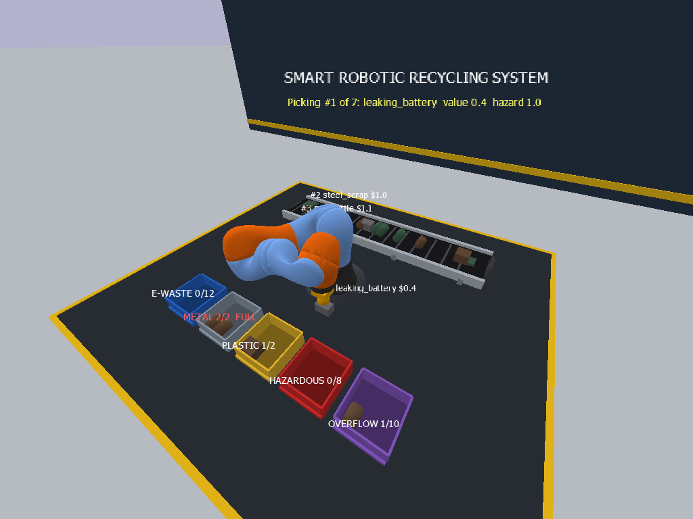
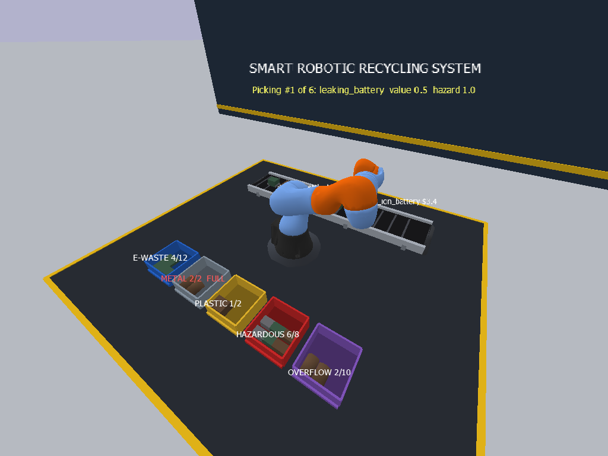
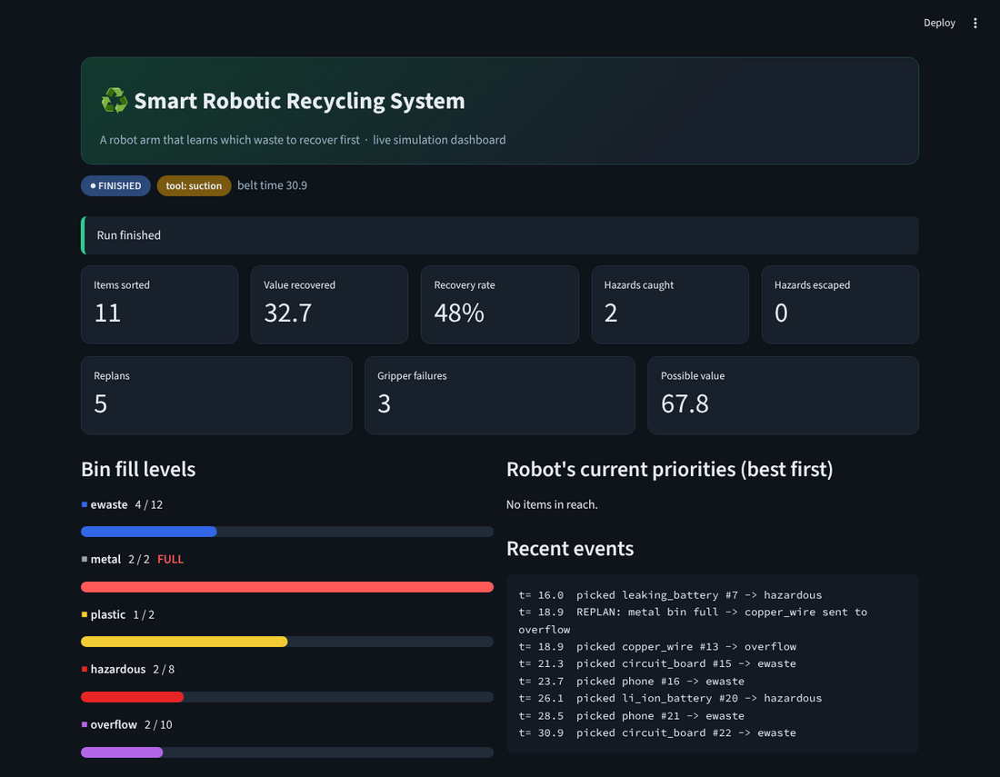

# Smart Robotic Recycling System

A 3D simulation of a robot arm sorting waste on a conveyor belt. It does **not** sort by colour. Each item gets a
**recovery score** from its material value, contamination, hazard level and recovery cost, and the robot picks the
most important item first. It **learns** better priorities by trial and error (reinforcement learning) and
**replans** when a bin is full or its gripper fails. A **live dashboard** shows the results.





## Software
Python, PyBullet (3D physics), NumPy (scoring + learning), Streamlit / Matplotlib (dashboard + graphs), GitHub.
Needs only a laptop. **Use Python 3.10-3.12** (PyBullet does not install cleanly on 3.13).

## Run it
```bash
pip install -r requirements.txt
python main.py train            # robot learns item priorities (~10 s) -> weights.npy, results/learning_curve.png
python main.py compare          # colour vs fixed score vs learned -> results/comparison.png / .csv
python main.py demo             # 3D robot window; --speed 6 for faster, --speed 1 for slow motion
                                # (add --headless --screenshots out/ to run without a window)
streamlit run dashboard/app.py  # live dashboard; run in a second terminal while the demo is running
python -m pytest                # tests
```

## How it works
| Part | File | What it does |
|---|---|---|
| Items | `brain/items.py`, `config.py` | 9 waste types (circuit boards, phones, copper, cans, plastics, batteries...) with value, contamination, hazard and cost |
| Score | `brain/scoring.py` | score = weights x [value, contamination, hazard, cost, urgency] |
| Planner | `brain/planner.py` | picks the best visible item; colour and FIFO modes are the baselines |
| Environment | `brain/env.py` | fast belt simulation: items arrive, leave if not picked, bins fill, gripper can fail |
| Learning | `brain/learner.py` | REINFORCE starts with zero knowledge and tunes the score weights |
| 3D scene | `sim/world.py`, `sim/robot.py`, `sim/demo.py` | PyBullet belt, bins and KUKA iiwa arm (inverse kinematics) driven by the same planner |
| Dashboard | `dashboard/app.py` | reads `logs/live_metrics.json` once per second |

**Replanning**
- *Bin full*: the item goes to the overflow bin (worth half), or is skipped if that is full too.
- *Gripper failure*: the robot retries, and after two failures switches to a slower but reliable backup suction tool.

The 3D demo uses tiny metal/plastic bins and two forced gripper failures so both replanning cases show up.
The belt and carried items move kinematically from the simulation clock; the arm uses PyBullet physics.

## Results (200 unseen episodes)
See `results/comparison.csv`. Both score-based methods recover about 82-83% of the possible value against about 64% for colour sorting.
The learned weights match the hand-tuned fixed score on value and miss fewer hazardous items.
